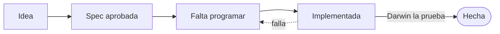
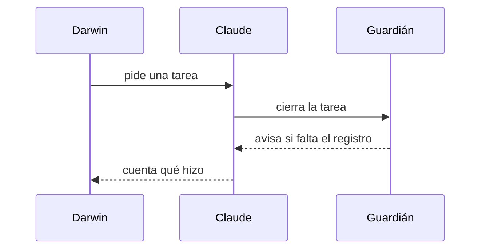

# Cómo se trabaja con Cerebro Vivo

Ejemplo para ver cómo quedan las diapositivas (2026-11-12).

---

## La idea en una frase

- La IA **no recuerda** entre chats.
- Por eso la memoria vive en **archivos**.
- Se lee un índice corto y solo se abre el detalle si hace falta.
- Lo no probado se dice como **sin probar**.

---

## El ciclo de una tarea (diagrama de cajas)

---

## Una tabla

| Carril | Cuándo | Primer paso |
| :--- | :--- | :--- |
| Spec primero | Toca más de 2 archivos o algo sensible | Escribir la spec |
| Fast-Track | Todo lo demás | Aplicar el cambio |

---

## Dos carriles de trabajo

1. **Spec primero:** se escribe, Darwin la aprueba, y entonces se programa.
2. **Fast-Track:** cambio pequeño, pruebas en verde, cierre.
3. En los dos, **cerrar es parte de trabajar**.

---

## Quién habla con quién (secuencia)

---

## Qué vigila solo

- El arranque cuenta el estado real al abrir el chat.
- El cierre avisa si falta la línea del registro.
- Los guardianes avisan de secretos, archivos gordos e índices rotos.
- Nada irreversible ocurre sin tu orden.

---

## De dónde sale esto

- `.brain/biblioteca/CEREBRO_VIVO.md`
- `.brain/constitution.md`

¿Qué te parece el formato?
