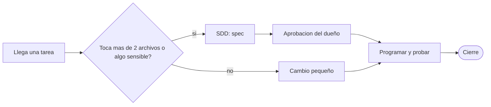
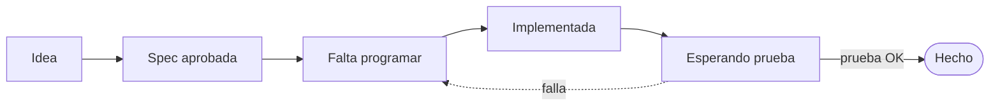

# Carta del Meta-Arnés «Cerebro Vivo»

La carta maestra con la que Darwin arma el arnés de trabajo con IA de todos sus proyectos. Versión 0.24 de la carta.

---

## Índice de la carta

- **La idea:** §0 a §2
  - §0 Cómo leer esta carta · §1 Propósito y promesa · §2 Principios
- **Las piezas:** §3 a §9
  - §3 Las 7 capas · §4 Archivos y topes · §5 Lectura de arranque
  - §6 Los dos carriles · §7 Ciclo de una tarea · §8 Checklist de cierre · §9 Guardianes
- **Cómo se trabaja:** §10 a §15
  - §10 Varias IA y chats · §11 Conducta de la IA · §12 Repo y memoria personal
  - §13 Biblioteca · §14 Kit de arranque · §15 Niveles de adopción
- **Qué sabemos y qué falta:** §16 a §20
  - §16 Lecciones · §17 Evidencia · §18 Hoja de ruta · §19 Huecos · §20 Proyectos
- **Apoyo:** §21 a §25
  - §21 Versiones · §22 Seguridad · §23 Plantillas · §24 Glosario · §25 Mantenimiento

---

## 0. Cómo leer esta carta

- Entender la idea: §1 y §2.
- Montar un proyecto nuevo hoy: §14 (kit de arranque) y §15 (qué nivel elegir).
- Saber qué vigila solo: §9.
- Evitar errores ya cometidos: §16.
- Ver qué falta del método: §18 y §19.

---

## 1. Propósito y promesa

- **El problema:** la IA no recuerda entre chats, el contexto cuesta dinero y el dueño no técnico no puede auditar el código.
- **Promesa 1:** retomar un proyecto tras días, o con otra IA, sin repetir explicaciones.
- **Promesa 2:** leer poco al empezar y buscar el detalle solo cuando hace falta.
- **Promesa 3:** que el dueño vea el estado real sin leer código.
- **Promesa 4:** que nada irreversible ocurra sin su orden.
- **Promesa 5:** que el método se cumpla solo donde se pueda.

---

## 2. Principios (las leyes del arnés)

- La verdad está en los archivos y el código, no en la conversación.
- Índice primero, detalle después; cada cosa en su sitio.
- Cerrar es parte de trabajar; «implementada» no es «terminada» (terminada = el dueño la probó).
- El porqué se guarda; lo que una máquina puede vigilar no se deja a la disciplina.
- Alcance estricto; lo irreversible se pregunta; lo no probado se dice como no probado.
- Lenguaje llano, medir antes de afirmar y cero dependencias cuando se pueda (son 14 principios en total).

---

## 3. Anatomía: las 7 capas

- **Dueño** (decide, aprueba, prueba) e **índices de entrada** (`CLAUDE.md`, `GEMINI.md`, `AGENTS.md`).
- **Reglas:** `constitution.md`.
- **Estado:** `pendientes.md`, `decisions.log`, `archive/`.
- **Conocimiento:** `architecture/`, `specs/` y las guías.
- **Guardianes:** vigilantes automáticos, tests y el hook `Stop`.
- **Biblioteca** (material reutilizable) y, fuera del repo, la **memoria personal del asistente**.

---

## 4. Estructura de archivos y topes

- Índices de entrada: **5 KB cada uno**, con el mismo contenido, vigilados por una prueba.
- `pendientes.md`: solo lo que falta, **tope 8 KB**.
- `decisions.log`: una línea por tarea cerrada, solo se añade al final.
- `decisions/`, `specs/`, `architecture/` y `archive/` guardan el detalle.
- Escala real en LoboHook (a 2026-11-01): unas 50 specs vivas, 72 decisiones y 992 pruebas.

---

## 5. Lectura de arranque y presupuesto de tokens

- **Se lee siempre:** el índice, la constitución, los pendientes y una ficha del área.
- **Solo si toca:** el índice de decisiones, el de hechos y la spec de la tarea.
- **Nunca completo:** `decisions.log`, `hechos.md` y el historial antiguo.
- Lectura propia estimada: unos 10.000 tokens frente a unos 150.000 si se leyera todo.
- Medido: el arranque cuesta unos 69.000 tokens en todos los chats; lo que sí se controla es la longitud del chat.

---

## 6. Los dos carriles (cómo se decide el trabajo)

- Si dudas entre los dos carriles, es SDD.

---

## 7. Ciclo de vida de una tarea

- Los números de `pendientes.md` son fijos; los huecos son tareas hechas.

---

## 8. Checklist de cierre (obligatorio, cada tarea)

- Pruebas en verde y una línea en `decisions.log`.
- Decisión importante: ficha `D-NNN` y su fila en el índice.
- `pendientes.md` al día, y pasar a hechos lo que el dueño ya probó.
- Mapa de funcionalidades y herramientas al día si cambiaron.
- Preferencias nuevas del dueño a la memoria personal del asistente.
- Resumen en llano: qué quedó, qué probar y **qué no se verificó**.

---

## 9. Guardianes (que el método se cumpla solo)

- Solo Python estándar; los ajustes viven en `guardianes.json`.
- **Aviso de cierre:** avisa si se editó sin dejar la línea en el registro.
- **Arranque:** resume el estado real al abrir el chat.
- **Poda, análisis de código, base de datos, secretos, librerías y pruebas:** avisan; el de secretos bloquea el commit si hay una clave real.
- **Longitud de chat** (avisa a los 200k tokens) y **notas de chats auxiliares**.
- No leen mensajes ni envían nada fuera. En Gemini y Codex solo se cumple en parte.

---

## 10. Varias IA, varios chats, sesiones auxiliares

- Un solo cerebro (`.brain/`) para todas las IA; los tres índices son espejo.
- Chats numerados y cortos: la IA avisa cuando se alarga.
- **Traspaso entre chats:** se escribe `traspaso.md` antes del chat nuevo y el arranque lo muestra.
- **Notas de auxiliares:** el chat que sale de otro deja una nota corta al terminar.
- Los avisos en el chat abierto en Codex y Gemini **no están comprobados en vivo**.

---

## 11. Reglas de conducta de la IA (portables)

- Responder en el idioma del dueño, directo y sin jerga.
- Alcance estricto: nada de refactors no pedidos.
- Consultar lo decidido antes de cambiarlo.
- Commits solo cuando se pide; nunca subir a internet sin orden.
- Irreversible = preguntar; no inventar; probar en la plataforma real.

---

## 12. Qué va en el repo y qué en la memoria personal del asistente

- **En el repo:** lo que cualquier IA necesita saber del proyecto (reglas, estado, decisiones, specs).
- **En la memoria personal:** quién es el dueño, cómo prefiere que se le hable y las correcciones que valen entre proyectos.
- No se duplica en memoria lo que ya está en el repo.
- Si una memoria resulta falsa, se borra.

---

## 13. Biblioteca y herramientas

- `herramientas.md`: una fila por herramienta usada (para qué, licencia o coste, estado).
- Antes de buscar algo, se mira ahí.
- Reglas fijas: cero dependencias, mirar la licencia comercial, tiempo máximo y plan B en toda llamada externa.
- Nada de secretos en el repositorio.
- Si algo exige crédito, queda anotado como condición de publicación.

---

## 14. Kit de arranque (proyecto nuevo, en orden)

- Atajo: `instalar.py DESTINO …` hace los pasos por ti y `--comprobar` prueba los guardianes; también hay ventana con doble clic.
- A mano: crear la carpeta, copiar el manual y la carta, y pedir a la IA que cree la estructura.
- Instalar los guardianes, el hook `Stop`, reiniciar y **probarlos antes de confiar**.
- Escribir la primera spec solo cuando una tarea lo exija; anotar el proyecto en §20.
- Opcional: kit de traducción para los idiomas del producto.
- **No cambiar:** los 14 principios, el ciclo de vida ni el checklist de cierre.

---

## 15. Niveles de adopción

- **Ligero:** `CLAUDE.md`, `pendientes.md` y `decisions.log`; para proyectos de pocos días.
- **Medio:** añade constitución, decisiones con porqué, specs y archivo de hechos; para semanas.
- **Completo:** añade guardianes, biblioteca, multi-IA y memoria personal; para meses o datos sensibles.
- No usarlo en prototipos de un día ni experimentos sin consecuencias.

---

## 16. Lecciones aprendidas (casos reales)

- `pendientes.md` llegó a 20 KB: ahora solo lleva lo que falta, con tope y guardián.
- Chats de 300 a 470k de contexto: avisar y abrir uno nuevo.
- El medidor se rompía en la consola de Windows: probar siempre en la plataforma real.
- El aviso de cierre callaba por un registro viejo: ahora comprueba lo editado en esa respuesta.
- Una prueba de guardián que no podía fallar no probaba nada.
- «Implementada» se daba por «hecha» sin la prueba del dueño.

---

## 17. Evidencia: qué se ha medido y qué no

- **Medido:** el arranque cuesta unos 69k tokens y el método añade unos 8 a 10k.
- **Medido:** cerrar tareas pesa como máximo el 11 % de los tokens nuevos; lo que más pesa es la longitud del chat.
- **Estimado, no medido:** el ahorro de lectura del arranque (~90 %); no hay un chat «sin método» para compararlo.
- **Comprobado en vivo:** el hook `Stop` salta solo en los casos esperados.
- **Sin verificar:** el comportamiento del hook en otro sistema operativo o en otra IA.

---

## 18. Hoja de ruta del arnés

- Hechos: prueba en vivo del hook, fichas con archivos, avisos de tamaño y de longitud de chat.
- Hechos y probados por el dueño: kit de arranque, kit de traducción y los guardianes 7 a 12.
- Codex y Gemini: arrancan solos en un chat nuevo; el cierre sigue siendo manual.
- La poda de memoria está encendida; falta verla mover una spec real.
- El traspaso entre chats quedó resuelto y probado (spec 078).

---

## 19. Huecos conocidos (honestidad)

- Depende de que la IA lea los índices; el guardián solo detecta olvidos al cerrar.
- Mantener la memoria cuesta 3 o 4 escrituras por tarea, desproporcionado en cambios de una línea.
- Una ficha falsa se propaga; por eso se verifican contra el código.
- La aprobación de specs frena el trabajo si el dueño no está.
- El ahorro real no se puede medir con precisión.
- Los guardianes asumen Claude Code, Git y Windows con Python; **sin verificar fuera de Windows**.

---

## 20. Proyectos que usan el arnés

- **LoboHook:** nivel completo, desde 2026-10; es el origen del método.
- **Otro proyecto de Darwin:** kit de arranque, desde 2026-11, en uso.
- Cada proyecto nuevo se anota aquí.

---

## 21. Registro de versiones de la carta

- 0.1 (2026-10-28): primera carta completa, con principios, capas, kit y lecciones.
- 0.2 a 0.18 (2026-10-28): hook comprobado, Codex y Gemini, y guardianes 4 a 12.
- 0.19 a 0.21 (2026-10-31): traspaso entre chats, skills de experiencia y notas de auxiliares.
- 0.22 y 0.23 (2026-11-01): puesta al día de cifras y guardián 13.
- 0.24 (2026-11-01): avisos de notas para Codex y Gemini.

---

## 22. Seguridad y límites (portables)

- Claves y tokens en variables de entorno o archivos ignorados; escanear antes de cada subida.
- Pruebas con base de datos temporal, nunca con los datos reales.
- La IA no sube, borra, gasta, envía mensajes ni cambia permisos sola.
- Llamadas externas con tiempo máximo y plan B local.
- Acciones críticas con registro de auditoría; antes de tocar algo en vivo, instantánea y vuelta atrás.

---

## 23. Plantillas listas para copiar

- La carta trae plantillas de `pendientes.md`, de la fila de `decisions.log` y de la ficha `D-NNN`.
- También de `hechos`, de una spec, de la frase de traspaso a un chat nuevo y del hook de `settings.json`.
- Son texto para copiar; se ven completas en la carta.

---

## 24. Glosario en lenguaje llano

- **Arnés:** lo que rodea a la IA para que trabaje con orden. **Meta-arnés:** el que crea el arnés de cada proyecto.
- **Contexto:** lo que la IA tiene delante; cuanto más largo, más cuesta cada mensaje. **Token:** unidad de ese texto.
- **Spec:** ficha de lo que se va a construir, aprobada antes de programar.
- **Hook:** aviso automático en un momento fijo. **Guardián:** comprobación automática del método.
- **Commit:** foto de los cambios en el equipo. **Push:** subirlos a GitHub, solo con orden.

---

## 25. Cómo se mantiene esta carta

- Se actualiza cuando algo del método cambia, falla o se aprende, no por calendario.
- Cada cambio sube la versión y corrige las lecciones y lo comprobado.
- Lo comprobado y lo supuesto se distinguen siempre.
- Al empezar un proyecto nuevo se copia la versión vigente.
- Si la carta y `CEREBRO_VIVO.md` se contradicen, manda la carta.

---

## Qué se presentó y qué se condensó

- Documento: `.brain/biblioteca/CARTA_META_ARNES.md` (versión 0.24).
- **Muy condensadas:** §4 (árbol de archivos), §9 (tabla de guardianes), §18, §21 (tabla de versiones) y §23 (plantillas, sin su texto).
- Los diagramas de §6 y §7 son dibujos nuevos a partir de las tablas y el esquema del original.
- Lo que se resumió puede haber perdido matices: la fuente completa es la carta.
