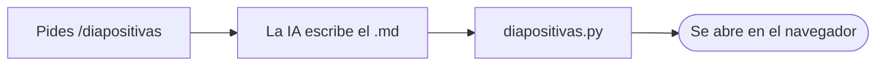

# cerebro-vivo: dónde estamos

Resumen del estado del proyecto, 2026-11-13. Arnés versión **1.46.1**.

---

## Qué es

- Es el **meta-arnés «Cerebro Vivo»**: el método, los guardianes, las skills y los kits.
- Cada proyecto de Darwin trae las mejoras con `actualizar_arnes.py`.
- Aquí vive el origen único: nada de LoboHook ni de otro proyecto entra.

---

## Lo hecho en este tramo

- **1.45.0:** `/diapositivas`, presentaciones que se abren en el navegador sin instalar nada.
- **1.46.0:** diagramas dentro de las diapositivas (cajas y secuencia), sin internet.
- **1.46.1:** los dibujos anchos ya no agrandan el texto.
- Diagramas **probados por Darwin**: «básicos, pero sirven».

---

## Cómo se hace un diagrama

---

## Estado de los archivos

- Todo lo hecho está **commiteado**; las pruebas pasan (543, 6 saltadas).
- **8 commits sin subir a GitHub**: allí solo está la 1.16.1.
- No se sube nada sin orden de Darwin.
- Página pública (`gh-pages`): hay que revisarla antes de subirla.

---

## Esperando la prueba de Darwin (9)

- **49:** `/diapositivas` con un trabajo real (esta presentación es parte de esa prueba).
- **23, 29, 30, 31, 35, 36:** guardianes, avisos y cierre; faltan pruebas en uso real.
- **42:** modo colaborativo y Gemini como obrera; Gemini **sin probar**.
- **43:** proyectos hermanos; **sin probar con proyectos reales**.

---

## Falta programar (8)

- **37:** repetir la prueba de seguridad con `vcsim`; necesita el sí de Darwin para instalar Go.
- **44 a 48:** ideas del texto de Karpathy (revisión de contenido, archivar respuestas, búsqueda local, efecto en cadena, tipo en el registro).
- **51:** más tipos de diagrama (aparcado por Darwin).
- **52:** vídeo de las diapositivas, spec 047 en borrador (aparcado por Darwin).

---

## Lo que NO se debe hacer

- No subir a GitHub ni cambiar la visibilidad del repo sin orden.
- No empezar el vídeo ni más diagramas sin que Darwin lo pida.
- No actualizar proyectos (LoboHook, Guild Control, Pegatinas…) sin orden.
- Lo no probado se dice como **sin probar**.

---

## Archivos de los que sale todo

- `.brain/pendientes.md`, `.brain/decisions.log`, `CAMBIOS.md`, `VERSION`
- Specs 045, 046 y 047 en `.brain/specs/`
- `.brain/archive/hechos-indice.md`
